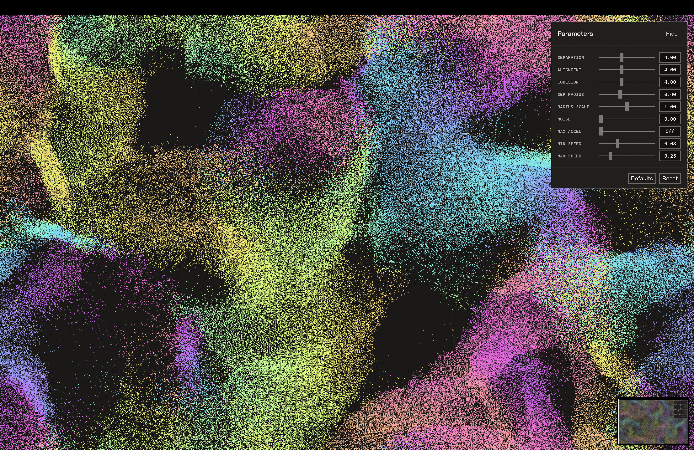

# rust boids sim

relatively lightweight boids algo sim with rust & wgpu

optimized on apple silicon (m4)



## usage

### run it:

```
cargo run --release
```

### tunable parameters:

- **separation**: tendency to push away from neighbors
- **alignment**: tendency to match heading of neighbors
- **cohesion**: tendency to steer toward center of neighbors
- **sep radius**: proximity to neighbors before separation
- **radius scale**: perception radius multiplier
- **noise**: randum turning
- **max accel**: steering cap
- **min/max speed**: does what it says on the box
